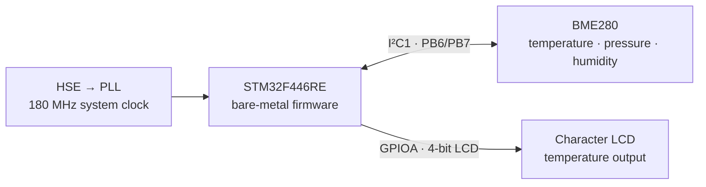

# BME280 LCD Monitor

<div align="center">

**A register-level, bare-metal environmental monitor for the STM32F446RE.**

Reads temperature, pressure, and humidity from a Bosch BME280 over I²C, then uses a character LCD to display the current temperature.

<br>


</div>

> **Early project draft:** this repository is an active learning prototype, not a production-ready driver. The sensor measurements and peripheral behavior still need systematic validation on hardware.

## At a glance

| | |
|---|---|
| **Target** | STM32F446RE, Cortex-M4F |
| **Sensor** | Bosch BME280, I²C mode, default 7-bit address `0x77` |
| **Display** | HD44780-compatible character LCD, 4-bit interface |
| **Peripheral access** | Direct register access; no STM32 HAL or CubeMX-generated application |
| **Toolchain** | GNU Arm Embedded Toolchain and GNU Make |
| **Current display output** | Temperature; pressure and humidity are read and compensated but not yet shown |

## What it does

The firmware starts from a hand-written Cortex-M4 startup routine, configures the system clock, initializes the LCD and I²C1, reads the BME280 calibration coefficients, and repeatedly obtains compensated sensor readings.



In the current application loop, all three measurements are calculated, but only temperature is formatted and sent to the LCD. The pressure and humidity values are not currently displayed.

## Hardware and wiring

### BME280 → STM32F446RE

| BME280 signal | STM32F446RE connection | Notes |
|---|---|---|
| `VCC` / `VIN` | Board supply supported by your breakout | Check the breakout documentation; use 3.3 V logic. |
| `GND` | `GND` | Sensor and MCU must share ground. |
| `SCL` | `PB6` (`I2C1_SCL`) | I²C clock. |
| `SDA` | `PB7` (`I2C1_SDA`) | I²C data. |
| `CSB` | High | Selects I²C mode on the BME280. |
| `SDO` | High for `0x77`; low for `0x76` | The current driver uses `0x77`; update `address` in `src/bme280.c` if your module selects `0x76`. |

SDA and SCL require pull-up resistors. The firmware enables the MCU's internal pull-ups, but suitable external pull-ups are recommended for a reliable bus. Use a breakout board with appropriate level compatibility; do not assume every module accepts 5 V.

### Character LCD → STM32F446RE

The LCD driver uses a 4-bit data bus and reads the busy flag, so connect `RW` rather than tying it permanently low.

| LCD signal | STM32F446RE pin |
|---|---|
| `RS` | `PA5` |
| `RW` | `PA6` |
| `E` | `PA7` |
| `D7` | `PA9` |
| `D6` | `PA8` |
| `D5` | `PA12` |
| `D4` | `PA11` |

Connect the LCD's power, ground, and contrast/backlight circuitry according to its module documentation. The LCD and MCU must share a common ground.

## Build and flash

### Prerequisites

- GNU Arm Embedded Toolchain (`arm-none-eabi-gcc`, `arm-none-eabi-objcopy`, and related binutils)
- GNU Make
- OpenOCD and an ST-Link for flashing

For Ubuntu or Debian-based systems:

```sh
sudo apt update
sudo apt install gcc-arm-none-eabi binutils-arm-none-eabi make openocd
```

### Compile

From the repository root:

```sh
make
```

The build produces `build/app.elf` with debug information. The project is compiled for the Cortex-M4 with the hard-float ABI.

To remove generated object and build files:

```sh
make clean
```

### Flash with ST-Link

Connect the target board, then run:

```sh
make flash
```

The Makefile invokes OpenOCD with `interface/stlink.cfg` and `target/stm32f4x.cfg`, then programs and verifies the generated image.

> **Clock prerequisite:** `src/rcc.c` expects an 8 MHz HSE clock source and configures the MCU for a 180 MHz system clock (PCLK1 at 45 MHz). Confirm the oscillator source and board setup match this assumption. The current startup and clock code waits indefinitely for clock-ready flags, so a mismatch can leave the firmware stalled before `main()`.

## Firmware overview

| Component | Responsibility |
|---|---|
| `src/main.c` | Initializes the display and peripherals, configures the BME280, and runs the measurement/display loop. |
| `src/rcc.c` | Enables the external oscillator, configures the PLL and bus clocks, and enables the Cortex-M4 FPU. |
| `src/i2c.c` | Configures I²C1 on PB6/PB7 and implements blocking register-level transfers. |
| `src/bme280.c` | Reads calibration data and raw measurements, then applies integer compensation calculations. |
| `src/lcd.c` | Initializes and drives the LCD in 4-bit mode using GPIOA. |
| `startup/startup_stm32f446.s` | Defines the vector table, initializes `.data` and `.bss`, and calls `SystemInit()` and `main()`. |
| `linker_script.ld` | Maps the image to 512 KiB of Flash and 128 KiB of SRAM. |
| `inc/` | Public driver interfaces and STM32/Cortex-M device headers. |
| `Makefile` | Builds the ELF, reports its size, provides inspection and flash targets, and cleans generated files. |

The application currently calls:

```c
bme280_setup(0x04, 0x04, 0x04, 0x03, 0x01, 0x00);
```

These are encoded oversampling, operating-mode, standby, and filter settings. Their effective behavior should be confirmed against the BME280 datasheet and on-device register reads before relying on them.

## Repository map

```text
.
├── inc/
│   ├── bme280.h
│   ├── core_cm4.h
│   ├── i2c.h
│   ├── lcd.h
│   ├── mpu_armv7.h
│   ├── stm32f446xx.h
│   └── system_stm32f4xx.h
├── src/
│   ├── bme280.c
│   ├── i2c.c
│   ├── lcd.c
│   ├── main.c
│   └── rcc.c
├── startup/
│   └── startup_stm32f446.s
├── linker_script.ld
├── Makefile
└── README.md
```

## Development status

This project is being developed as a way to explore MCU startup, clock configuration, GPIO, I²C transactions, sensor compensation, and LCD control without a high-level peripheral library.

### Current limitations

- I²C transfers are blocking and have no timeout, so a bus fault or missing device can hang the firmware.
- NACKs and other bus errors do not yet have robust status reporting or recovery.
- The driver does not currently validate the BME280 chip ID or report sensor setup/read failures.
- Calibration parsing, compensation math, and the selected sensor settings have not yet been comprehensively checked against reference data.
- The loop calculates pressure and humidity but currently displays only temperature.
- The LCD and sensor paths assume correctly connected hardware and valid output pointers.
- There is no automated test suite or hardware-validation procedure in the repository yet.

### Planned next steps

1. Add sensor identity checks, explicit transfer status, and bounded I²C waits.
2. Verify register reads and writes with a logic analyzer and compare calibration/compensation results with Bosch reference data.
3. Validate clock, sensor configuration, and measurements on the target board.
4. Display pressure and humidity, and improve formatting and update behavior.
5. Add focused tests for register encoding, calibration parsing, and compensation calculations.

## Debugging

The project can be debugged with GDB and an ST-Link/OpenOCD setup. The ELF includes debug information; configure your preferred Cortex-M debugger to load `build/app.elf` and use the same OpenOCD interface/target configuration as the flash target.

## License

See [LICENSE](LICENSE) for the project license. Third-party device headers retain their own copyright and license notices.
